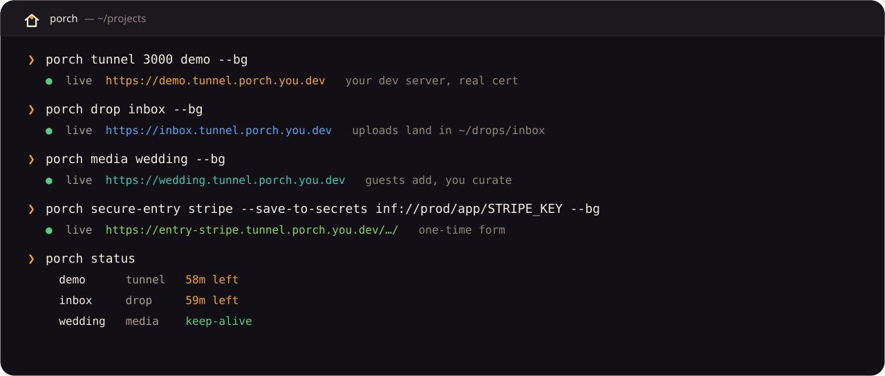

<p align="center">
  
</p>

<p align="center">
  <a href="https://github.com/Hexidecibel/porch/actions/workflows/test.yml"></a>
  <a href="LICENSE"></a>
</p>

<p align="center">
  <a href="#install-in-60-seconds"><b>Install</b></a> &nbsp;·&nbsp;
  <a href="https://hexidecibel.github.io/porch/showcase/">Showcase</a> &nbsp;·&nbsp;
  <a href="docs/compare.md">Compare</a> &nbsp;·&nbsp;
  <a href="docs/guides/README.md">Guides</a> &nbsp;·&nbsp;
  <a href="docs/features.md">Features</a> &nbsp;·&nbsp;
  <a href="docs/tools.md">Tools</a> &nbsp;·&nbsp;
  <a href="docs/security.md">Security</a>
</p>

**Porch is a self-hosted front porch for your server: small, ready-made web
pages for sending things, receiving things and letting people in, each on its
own link on your domain, each closing when you say so.**

- **Send a huge video with a link that dies after one download.** `porch share --e2e --burn video.mp4`: sealed before it leaves, so your own box only ever holds ciphertext.
- **Collect the wedding photos from every guest into one album.** `porch media wedding --bg`: guests open a link and add photos and videos, no accounts; only you can delete.
- **Show a client your dev server on a real HTTPS URL.** `porch tunnel 3000 demo --bg` gives `https://demo.tunnel.porch.example.com`, real certificate, gone in an hour.
- **Get an API key from someone without it touching chat or email.** `porch secure-entry stripe --bg`: a one-time form that saves straight to a 0600 file, Infisical or 1Password.
- **Answer "can I come in?" from your phone.** A visitor at a closed door or a private app taps *Ask*; the [Porch app](docs/pocket-app.md) notifies you, and a closed door reopens with *Allow 1h* right on the lock screen.

All on your own domain. No account, no cloud, one box.

<p align="center"><a href="https://hexidecibel.github.io/porch/showcase/"><b>▶ See all 21 apps and pages in the showcase</b></a>, on a phone and a desktop.</p>

<p align="center">
  
</p>

**Who it's for:** self-hosters and homelabbers with a domain and a box: a
machine at home (plus a $4-5 relay if your router can't forward ports) or a
$6 VPS.

## What you get

<table>
<tr>
<td width="33%" valign="top"><b>Share anything</b><br><code>porch share</code> a file, folder, PDF, log or <code>git diff</code>; it picks the right viewer.</td>
<td width="33%" valign="top"><b>Doors with rules</b><br>Every link can expire, ask for a password, hand out a guest link or burn after one open.</td>
<td width="33%" valign="top"><b>Receive, safely</b><br>Upload pages, photo and video albums, and one-time forms for secrets that never touch a chat.</td>
</tr>
<tr>
<td valign="top"><b>End-to-end encrypted</b><br><code>--e2e</code> seals a file before it leaves; the key lives in the link, never on the server.</td>
<td valign="top"><b>The Porch app</b><br>Your phone runs the box: doors, devices, requests, push notifications, passkey step-up.</td>
<td valign="top"><b>Inspect webhooks</b><br>Record every request through a door, secrets masked; replay one against your app.</td>
</tr>
<tr>
<td valign="top"><b>Ask to reopen</b><br>A visitor at a closed door taps once; you get Allow 1h / 24h on your lock screen.</td>
<td valign="top"><b>Your other machines</b><br>Pair a laptop with a code; each device gets its own revocable token.</td>
<td valign="top"><b>Agents welcome</b><br><code>porch mcp</code> lets an AI agent share files and ask you for things, never seeing your secrets.</td>
</tr>
</table>

<p align="center">
  
</p>

Built on the Python standard library, [frp](https://github.com/fatedier/frp),
HAProxy and certbot. No database, no containers, no telemetry. The full tour:
**[docs/features.md](docs/features.md)**.

## Porch vs. the usual suspects

Porch is not a hosted tunnel service. It is the apps around a tunnel, on
hardware and a domain you already have.

| | Porch | ngrok | Cloudflare Tunnel | Tailscale Funnel |
|---|---|---|---|---|
| Your own domain | yes | paid plans | yes, on Cloudflare DNS | no (`ts.net` names) |
| Built-in pages to send and receive (uploads, albums, secrets, E2E shares) | yes | — | — | — |
| Link rules | expiry, password, guest link, burn | auth and IP rules | Cloudflare Access login | — |
| Needs your own server and a domain | **yes** | no | a domain | no |
| Maturity | **new** | established | established | beta |

The full table (accounts, TLS, open source, price, and frp): **[docs/compare.md](docs/compare.md)**.

## Install in 60 seconds

On a fresh Ubuntu 22.04/24.04 or Debian 12/13 server (amd64 or arm64), with a
domain:

```bash
curl -sSL https://raw.githubusercontent.com/Hexidecibel/porch/main/site/porch.sh | sudo sh -s -- --domain example.com
```

On a server that already runs other things, look first: `--check` is a
read-only report of everything the installer would change and anything that
would stop it.

```bash
curl -sSL https://raw.githubusercontent.com/Hexidecibel/porch/main/site/porch.sh | sudo sh -s -- --check
```

([`site/porch.sh`](site/porch.sh) installs the latest
[GitHub release](https://github.com/Hexidecibel/porch/releases); a running
Porch's landing page serves its own copy too.) It installs what it needs,
creates a `porch` user, downloads Porch and frp (sha256-checked) and prints a
one-time link to the setup wizard. The wizard asks for your domain, how
visitors reach the box, your DNS provider and an admin password, then sets up
HAProxy, frps, DNS, a Let's Encrypt certificate and the services, live.

Then:

```bash
porch tunnel 8080 myapp --bg      # https://myapp.tunnel.porch.example.com
porch share report.pdf            # the right viewer, on its own link
porch drop inbox --bg             # an upload page; files land in ~/drops/inbox/
porch status                      # what's open
```

Home box, by hand, unattended setup, other machines: **[docs/install.md](docs/install.md)**.

## Pick how people reach you

Visitors need to reach TCP 80, 443 and 7000 on your box. `porch connect --status`
looks at your network and recommends one of these:

| Your box | Mode | Cost / month | Guide |
|---|---|---|---|
| A VPS with a public IP | `direct` | the VPS ($6) | [Fresh VPS](docs/guides/fresh-vps.md) |
| At home, you can change router settings | `manual` | $0 | [Port forward](docs/guides/home-port-forward.md) |
| At home, router speaks UPnP / NAT-PMP | `upnp` | $0 | [Automatic router setup](docs/guides/home-upnp.md) |
| Behind CGNAT or a locked router | `paid` | $4-5 relay | [Paid relay](docs/guides/home-paid-relay.md) |
| Same, with a server you already have | `byo` | $0 extra | [Your own server](docs/guides/home-byo-relay.md) |
| Same, free (experimental) | `oracle` | $0 | [Oracle Always Free](docs/guides/home-oracle-relay.md) |
| Already running HAProxy + frps | adopt | $0 | [Adopt a server](docs/guides/adopt-existing.md) |

A relay forwards raw TCP only: TLS terminates at your box, so the relay never
holds your key. Prices, transfer limits and what has been tested:
**[the comparison](docs/guides/README.md#cost-and-comparison)**.

## Learn more

- **[Porch compared](docs/compare.md)** with ngrok, Cloudflare Tunnel, Tailscale Funnel and frp
- **[Setup guides](docs/guides/README.md)**: one per path, with costs, verification and undo
- **[Features](docs/features.md)**: doors, rules, sharing, E2E, the Porch app, inspector, secrets, MCP
- **[Tools reference](docs/tools.md)**: every command, flag and limit
- **[Install](docs/install.md)**: requirements, by hand, unattended, other machines
- **[Security model](docs/security.md)** and **[How it works](docs/architecture.md)**
- **[Contributing](CONTRIBUTING.md)**: tests, conventions, testing connection modes
- More: [the Porch app](docs/pocket-app.md) · [its API](docs/pocket-api.md) ·
  [sharing from iPhone](docs/pocket-ios-shortcut.md) · [E2E format](docs/porch-seal.md) ·
  [MCP server](docs/mcp.md) · [setup engine design](docs/porch-setup-design.md)

## License

MIT. See [LICENSE](LICENSE).

<sub>Porch grew out of <b>cush-tools</b>, which is why a few scripts and
variables still say <code>cush</code>. Leave the light on.</sub>
