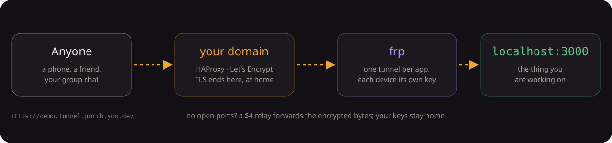

# How it works

<p align="center">
  
</p>

- **HAProxy** holds the wildcard certificate and terminates TLS for
  `*.tunnel.<domain>`, the auth host and the panel.
- **frps** receives tunnels from your machines; each door opens its own frpc
  tunnel. The **auth server** is frps's plugin: it checks every Login,
  NewProxy, NewWorkConn and heartbeat against a per-device token, so a revoked
  device is cut off within about a minute.
- **App servers** (one small stdlib Python process per door) bind `127.0.0.1`
  only. frp is the only way in.
- When a door has rules or the inspector, a **door proxy** sits in front of the
  app: it enforces the password gate, guest links, open counts and expiry, and
  records requests.
- The **status API** backs the panel and the Porch app; **Pocket** is the Porch
  app's server.
- Everything is configured from one file, `config/porch.toml` (every key
  optional, any key overridable by a `PORCH_*` environment variable):

```toml
[domain]
root = "porch.example.com"
# tunnel_base = "tunnel.porch.example.com"
# auth_host   = "auth.porch.example.com"
# panel_host  = "panel.porch.example.com"
```

`python3 lib/porch_config.py dump` shows the resolved values. Without a config
file the built-in defaults are the original author's domain, so set yours
(setup writes it for you).

Running the tests, conventions and the connection-mode test harnesses:
[CONTRIBUTING](../CONTRIBUTING.md). The setup engine's design:
[porch-setup-design.md](porch-setup-design.md).
